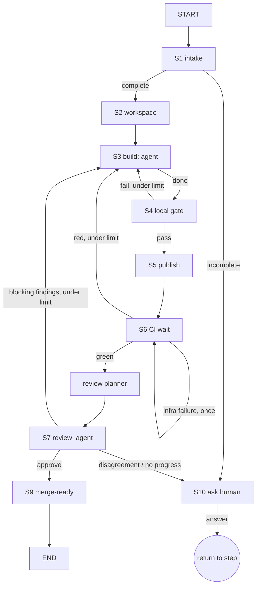

# LangGraph coding workflow — research record

> Research written for Alex on 2026-10-13 and addressed to you. It records what you asked for,
> what seven research passes found (with sources), and what is still open. The design spec comes
> is [../design.md](../design.md) and the plan is [../plan.md](../plan.md). The seven detailed
> research notes are in [notes/](notes/).

Status: **research complete; approach A chosen (see [../decisions.md](../decisions.md)).** Written
against `bodegus/openclaw2-deploy` `main` at `5f89337`.
Versions checked on PyPI the same day: `langgraph` 1.2.15, `langgraph-checkpoint-sqlite` 3.1.2,
`openai-codex` 0.162.1 (Production/Stable), `deepagents` 0.7.24 (Beta), `githubkit` 0.16.1.

Claims are marked **verified** (read in a primary source; link given) or **inferred** (our
reading). The detailed notes in [notes/](notes/) carry every permalink; this file keeps the links the
conclusions rest on.

## 1. What you asked for

Your words and decisions (2026-10-13):

- A prototype that runs the coding loop as a **LangGraph** workflow instead of the LLM conductor.
  The graph runs everything from a GitHub issue to a **merge-ready PR** and never merges.
- Builder and reviewer stay agentic, multi-turn loops, borrowed from an existing harness.
  Everything between them is plain code with no LLM. Example: when the builder finishes, poll
  GitHub Actions without LLM cycles; on failure go straight back to the builder.
- Use off-the-shelf Python libraries, not this repository's `ops/` code.
- It watches until the PR is merge-ready and survives restarts. OpenClaw supervises it later.
- A second Codex login is fine; a packaged workflow container is an option. You are on the Pro
  plan and expect the quota to be enough.
- Run on this Mac first, outside OpenClaw. For the local test the workflow may use your shell home,
  including your `gh` login; you keep full control.
- Manage the builder and reviewer steps with targeted, standardized agent skills in the repos.
- Spend no LLM tokens on declarative actions (push, monitor, then fix or move on).
- Size the review to the change with a decision step (light / medium / heavy, or 1–3 reviewers).
- Question: can the context stay "hot" between builder and reviewer, or must the important parts be
  captured explicitly, for example in the PR description or comments? **Decided:** the reviewer
  starts fresh, never from the builder's context; CI-fix and review-fix rounds continue the
  builder's own thread so its context is kept.

Delivery in phases (your words, 2026-10-13):

1. **Phase 1**: get the process working end to end, from issue to PR. Then run three workflows and
   inspect the detailed session logs: a simple issue (a version bump), a medium issue (a feature in
   `family-calendar`) and a complex issue (a feature in `memgo-app`).
2. **Phase 2+**: iterate on the areas the logs show are most worth improving, until the local
   workflow is durable.
3. **Phase 3+**: migrate from the Mac to OpenClaw.

Assumed, not yet confirmed: Python, and LangGraph's library rather than a hosted LangGraph server
(see §12).

## 2. Why: what the conductor costs today

- The loop is sequenced by an LLM reading prose: the conductor's `SOUL.md` (256 lines) plus three
  phase skills (463 lines), with builder (237) and reviewer (208) contracts beside them: 1,164
  lines that a model must follow exactly (**verified**, line counts at `5f89337`).
- The week of 2026-10-07 shows the cost: delegation under the 9.9 Codex harness (bodegus/openclaw2-deploy#203, bodegus/openclaw2-deploy#205, bodegus/openclaw2-deploy#208;
  the harness tells the model to use `spawn_agent`, against our rules,
  [D-046](https://github.com/bodegus/openclaw2-deploy/blob/5f89337/docs/decisions/046-codex-delegation-config-limit.md)), bounding evidence excerpts (bodegus/openclaw2-deploy#218,
  bodegus/openclaw2-deploy#229), publication-approval wording (bodegus/openclaw2-deploy#220) and the builder's local-gate definition (bodegus/openclaw2-deploy#224)
  (**verified**, `git log`).
- Mature systems do the opposite: a deterministic outer process with the LLM inside bounded steps
  (GitLab Duo flows, Codex's two-job autofix, GitHub's gh-aw safe outputs, the OpenHands resolver;
  §9). Open SWE is the counter-example: its process lives in prompts and middleware, and its docs
  say so on purpose (§9).

## 3. Headline findings

1. **No mature open-source LangGraph pipeline from issue to merge-ready PR exists to fork.** GitLab
   Duo's flows are the closest design and run on LangGraph in production, but the licence allows
   reading, not copying. Open SWE (MIT, 11k★) was rewritten in 2026 as one LLM-driven Deep Agent;
   its CI watcher and reviewer pieces are worth copying. The outer graph is ours to write, and it is
   small (§4, §9).
2. **LangGraph 1.2 covers the outer graph**: typed state, pure routing functions, per-node retry,
   timeout and error handler, heartbeats as stuck detection, SIGTERM drain, typed human answers.
   Its traps: the default retry also retries HTTP 4xx and failed subprocesses; the recursion limit
   resets on every resume; a resumed node runs again from its start; and an open bug (langchain-ai/langgraph#8039) means
   even `durability="sync"` is not exactly-once. Every side effect must check before it acts (§7).
3. **The builder and reviewer harness should be the official Codex Python SDK**, `openai-codex`
   (stable). It runs Codex's own agent loop on a ChatGPT login with typed output, resumable and
   forkable threads, an untrusted-input channel and a read-only sandbox. `codex mcp-server` was
   removed in September, so the MCP route is gone (§5).
4. **Subscription auth is documented for trusted private automation**: a dedicated login in its own
   `CODEX_HOME`, one long-lived Codex process per login. All logins share the plan's limits.
   OpenAI's new "Sign in with ChatGPT" plan usage for third-party apps is a sanctioned preview
   alternative. Proxies that impersonate the Codex CLI should be avoided (§6).
5. **Run it as a plain Python process** with a SQLite checkpointer and a small CLI, under launchd.
   Not `langgraph dev` (Elastic licence, durability gap) and not LangGraph's Agent Server
   (production self-hosting needs an Enterprise licence and a LangSmith key; it phones home) (§7).
6. **CI wait is plain code**: poll by the exact pushed commit, classify with a pure function, fetch
   and trim failing job logs, re-run infrastructure failures once. This repo has no GitHub-required
   checks and two checks named `validate`, so the workflow keeps its own required list (§4 S6).
7. **GitHub access**: `githubkit` (async, REST and GraphQL, repo-scoped App tokens). "Ready for
   review" exists only in GraphQL. Fine-grained PATs cannot read check runs. Pushes made with
   Actions' `GITHUB_TOKEN` do not start CI (§4 S5, S6).
8. **Isolation is built into Codex for writes, not reads.** In `workspace-write`, `.git`, `.agents`
   and `.codex` stay read-only and network is off, so the builder cannot commit or push. Its sandbox
   does not stop reads of the login file by default; a deny-read rule works on macOS (§6).
9. **Skills fit Codex natively**: it loads `.agents/skills` (our format), can invoke a skill by
   name or path, and can take skills and `AGENTS.md` from a trusted folder so a builder cannot
   rewrite what the reviewer reads (§5).
10. **OpenClaw 9.9 has no durable workflow engine** (TaskFlow was removed in 9.7; Lobster is an
    optional 20-second tool). It is a good later host: a cron command job can tick the graph, as
    `oc2-backlog-poll` does today (§10).
11. **The expensive loop has known fixes, all in code**: pick the review level from the diff and
    paths, block only on P0/P1 findings inside the change, verify blocking findings first,
    re-review only what changed since the last review, never repeat a point, and cap rounds. Our
    conductor re-reviews the full diff every round, which is the documented way to get endless nits
    (§8).
12. **A resumed builder is "hot" only for a while**: Codex compacts at about 245k tokens and, on a
    ChatGPT login, keeps only user messages; the cache probably expires during a long CI wait. Every
    fix prompt restates the open findings, and a fresh builder seeded from the handoff takes over
    after two failed attempts or at about 60% of the context (§8.2).

## 4. The workflow, step by step

Only S3 and S7 use the LLM. Every other box is code. Limits are counters in graph state, checked
by small routing functions that can be unit-tested without a graph.

| Step | Runs as | Recommended approach | Examples found |
|---|---|---|---|
| S1 intake | code | fetch the issue; start only on issues you authored or labelled; require an acceptance-criteria section or checklist, otherwise ask | OpenHands label policy; SWE-agent PR guards; GitLab context builder; Copilot agent trigger rules |
| S2 workspace | code | bare mirror per repo, `git clone --local` per task, plain `git` CLI | Open SWE sandbox per thread; OpenClaw managed worktrees; GitLab executor split |
| S3 build | agent | Codex SDK thread, `workspace_write`, typed result, CI logs and findings as untrusted input | agno `CodexAgent`; machinist; IssueForge; Open SWE programmer |
| S4 local gate | code | commands from config, diff policy, bounded retries, stop on a repeated failure | Aider `--auto-test`; LangGraph code-assistant; GitLab `validate_fix_has_changes` |
| S5 publish | code | commit, push with lease, create-or-reuse draft PR; the only step with write credentials | Codex two-job autofix; OpenHands `send_pull_request.py`; gh-aw safe outputs |
| S6 CI wait | code | poll by pushed SHA, pure classifier, trimmed job logs, one infra re-run | Open SWE `/baby-sit`; Renovate `prNotPendingHours`; GitLab `fix_pipeline` |
| S7 review | agent | fresh read-only Codex thread, schema like Codex's review rubric, verdict computed in code | Codex built-in review; Open SWE reviewer; PR-Agent schema; GitLab `code_review` |
| S8 fix loop | code | findings ledger with stable ids, per-finding disposition, round caps, two-strike and no-progress rules | Open SWE v1 `maxReviewCount`; our conductor's own rules as data |
| S9 merge-ready | code | re-check head and checks, mark ready via GraphQL, one summary comment; no merge call anywhere | Copilot agent stops at draft; `gh pr ready` |
| S10 ask | code + interrupt | post the question idempotently, then pause; resume from a CLI or an allowed GitHub reply | LangGraph interrupts; Open SWE plan approval |

### S1 intake

- Fetch with `GET /repos/{o}/{r}/issues/{n}`; reject pull requests, closed issues and issues that
  someone else opened (**verified**,
  [REST issues](https://docs.github.com/en/rest/issues/issues?apiVersion=2022-11-28#get-an-issue)).
  Starting only on your issues is also what OpenAI's terms expect for plan usage triggered by
  automation (§6).
- Completeness is a rule, not a model call: a non-empty section headed like "Acceptance criteria"
  or "Done when", or at least one `- [ ]` item. Our own issues vary: bodegus/openclaw2-deploy#213 has the heading,
  bodegus/openclaw2-deploy#160 has only checklists, bodegus/openclaw2-deploy#223 has only "Ask:" (**verified**). Issue-form `validations` cannot help: GitHub
  enforces them only on public repositories (**verified**,
  [form schema](https://docs.github.com/en/communities/using-templates-to-encourage-useful-issues-and-pull-requests/syntax-for-githubs-form-schema)).
- Examples: OpenHands removes a `ready-for-dev` label unless the labeller has write access
  ([issue-readiness-check.yml](https://github.com/OpenHands/OpenHands/blob/b5d6b2ff2c90b3bb2a21a35cd396b61d88990831/.github/workflows/issue-readiness-check.yml));
  SWE-agent opens a PR only if the issue is open, unassigned, unlocked and not already referenced
  ([`open_pr.py`](https://github.com/SWE-agent/SWE-agent/blob/main/sweagent/run/hooks/open_pr.py));
  Copilot's coding agent lets only write-access users trigger it and strips hidden characters from
  issue text ([risks and mitigations](https://docs.github.com/en/copilot/concepts/security-governance-and-network-settings/risks-and-mitigations)).
  Counter-example: Open SWE v1 routed intake with an LLM classifier.

### S2 workspace

- One bare mirror per target repo, then a self-contained clone per task
  (`git clone --local <mirror> <task>/repo`). Worktrees share refs and config between tasks, which
  matters once an agent can write `.git` (**inferred** from
  [git-worktree](https://git-scm.com/docs/git-worktree)).
- Use the plain `git` CLI through `asyncio.create_subprocess_exec` with hooks disabled. GitPython
  is in maintenance mode; pygit2 lags git features (**verified**, see the GitPython README).
- On this Mac, Docker runs through Colima, which shares only `$HOME` with containers, so task
  folders belong under `$HOME` if a container is added later (**verified**,
  [Colima defaults](https://github.com/abiosoft/colima/blob/ad7a86041b9e93b24b30cc6b89451e6fd599f6dc/embedded/defaults/colima.yaml#L204-L272)).
- Examples: Open SWE keeps one sandbox per thread and reconnects to it on resume rather than
  replacing it; OpenClaw 9.9 can create managed worktree sessions (`sessions.create
  {worktree: true}`); GitLab Duo splits the service from a separate command executor.

### S3 build

- One Codex thread per task: `thread_start(sandbox=workspace_write, approval_mode=deny_all,
  developer_instructions=…)`, then `thread.run(task, output_schema=BuildResult)`. Save the thread id
  in graph state before the long turn so a crash resumes the same thread (§5).
- The issue body, CI logs and review findings go in as `ExternalMessage`, which Codex treats with
  tool-level authority, below user and developer instructions (**verified**,
  [SDK api-reference](https://github.com/openai/codex/blob/rust-v0.162.1/sdk/python/docs/api-reference.md)).
- Codex has no max-turns setting. Bound it from LangGraph: `TimeoutPolicy(run_timeout,
  idle_timeout)` with a heartbeat on every Codex event, then `TurnHandle.interrupt()`
  (**verified** API; wiring **inferred**).
- The builder's claims are checked in code afterwards: the diff is not empty, the listed files match
  `git diff`, no protected paths changed (**inferred**).
- Examples: agno's `CodexAgent` maps each session to one Codex thread and does not retry
  cancellations, budget or auth errors
  ([agent.py](https://github.com/agno-agi/agno/blob/1f2aac51eb28dc9c0970836d3b7ae046bae81bbb/libs/agno/agno/agents/codex/agent.py#L160-L250));
  machinist runs Codex SDK tasks and fails unless the turn completed with a final answer
  ([example](https://github.com/owainlewis/machinist/blob/main/examples/workflows/code-workflows/codex_example.py));
  IssueForge wraps `codex exec` as a LangGraph step
  ([repo](https://github.com/jackliujlu-bot/issueforge), a 1★ demo); Open SWE's programmer is a Deep
  Agent with ~30 middleware.

### S4 local gate

- Commands come from per-repo workflow config, never from the agent or the issue. A cheap diff
  policy runs first: protected paths (`.github/workflows/**`, CI scripts, lock files) go to you, an
  empty diff goes back to the builder, an oversized diff goes to you (**inferred**).
- Retry at most three times; the same failure fingerprint twice in a row means stuck (**inferred**).
- For this repository the gate cannot mirror CI on Apple Silicon: `ops/ci.sh` exits unless it runs
  on Linux x86_64 ([ops/ci.sh:19](https://github.com/bodegus/openclaw2-deploy/blob/5f89337/ops/ci.sh#L19)). CI is the real gate here; a local gate is a
  fast pre-filter for other repos.
- Examples: Aider feeds lint and test failures back to the model, capped at three reflections
  ([base_coder.py](https://github.com/Aider-AI/aider/blob/5dc9490bb35f9729ef2c95d00a19ccd30c26339c/aider/coders/base_coder.py#L1598-L1622));
  LangGraph's code-assistant example routes back with the error while `iterations < 3`; GitLab
  checks the fix changed something
  ([`resolve_sast_vulnerability` flow](https://gitlab.com/gitlab-org/modelops/applied-ml/code-suggestions/ai-assist/-/tree/main/duo_workflow_service/agent_platform/v1/flows/configs)).

### S5 publish

- The only step that holds GitHub write credentials. Commit with hooks disabled, push with
  `--force-with-lease` (an empty expected value means the branch must not exist yet), then find an
  open PR for the branch before creating a draft one. Each effect is a separate `@task` so a crash
  between push and PR does not push twice (**verified** semantics; design **inferred**).
- The token reaches `git` through `GIT_CONFIG_COUNT` / `GIT_CONFIG_KEY_0` / `GIT_CONFIG_VALUE_0`
  for that one command, never in argv or `.git/config` (**verified**,
  [git-config](https://git-scm.com/docs/git-config)).
- Push with a GitHub App token or PAT: pushes made with Actions' `GITHUB_TOKEN` do not start new
  workflow runs (**verified**, [GITHUB_TOKEN](https://docs.github.com/en/actions/concepts/security/github_token)).
- Examples: Codex's official autofix uses two jobs; the fix job has no write permission and the PR
  job has no OpenAI key ([non-interactive docs](https://learn.chatgpt.com/docs/non-interactive-mode));
  the OpenHands resolver re-applies the agent's patch on a clean clone and opens a draft PR
  ([send_pull_request.py](https://github.com/OpenHands/OpenHands/blob/7bc3300981fa1cb4689d6e1b0c0bdd7fd77ac954/openhands/resolver/send_pull_request.py),
  MIT); gh-aw validates protected files and patch size and makes draft PRs by default
  ([safe outputs](https://github.github.com/gh-aw/reference/safe-outputs/)); Copilot's coding agent
  "cannot directly run `git push`".

### S6 CI wait

- Poll inside one async node by the exact SHA that S5 pushed, with a heartbeat each round and a
  deadline. A crash re-enters the node and re-reads, which is harmless (**inferred**).
- Classify with a pure function. Open SWE's rules are good: no checks yet is pending, not success;
  a required check that has not reported keeps it pending; `cancelled` or `stale` is blocked (but a
  job timeout also ends as `cancelled`, told apart only by its annotation; §8.4)
  ([baby_sit.py](https://github.com/langchain-ai/open-swe/blob/0942b41561df7db968f3be7f1c5150819bdec6b8/openswe/baby_sit.py#L362-L410),
  [ci.py](https://github.com/langchain-ai/open-swe/blob/0942b41561df7db968f3be7f1c5150819bdec6b8/openswe/github/ci.py),
  MIT, worth copying).
- This repository's facts (**verified**, `gh api`, 2026-10-13):
  - `main` has a ruleset (no deletion, no force-push, PRs required) but **no required status
    checks**, so GitHub will not report lint, validate and unit as required. The workflow keeps its
    own list.
  - PR heads can carry two check runs named `validate` (from `CI` and from `Images`). Match by
    (workflow, job), not by name.
  - `ci.yml` cancels runs for older pushes, so `cancelled` on an old SHA is noise.
- Failing logs: fetch per job (`GET /actions/jobs/{id}/logs`); a real failed `unit` log was
  2,895 lines and 240 KB, and its annotations were useless. Trim to the failed step, error lines and
  the lines before the first error, about 8 KB per job, and pass it as untrusted text
  (**verified** shape; recipe **inferred**).
- Re-run once per SHA, only for infrastructure failures (cancelled, startup failure, runner lost);
  never for assertion failures (**inferred**; Open SWE allows three per head SHA).
- Examples: Open SWE `/baby-sit` (webhooks plus a 10-minute cron that "consumes no model tokens
  while state is unchanged"); Renovate bounds "pending forever" with `prNotPendingHours`
  ([docs](https://docs.renovatebot.com/configuration-options/#prnotpendinghours)); GitLab's
  `fix_pipeline` flow fetches failing jobs deterministically before any agent step
  ([flow](https://gitlab.com/gitlab-org/modelops/applied-ml/code-suggestions/ai-assist/-/blob/main/duo_workflow_service/agent_platform/v1/flows/configs/fix_pipeline/1.0.4.yml)).
  No well-known LangGraph graph has a CI-wait node; this will be original code.

### S7 review

- A fresh read-only Codex thread per review, on a separate checkout of the PR head, with
  `.agents/`, `.claude/`, `AGENTS.md` and `CLAUDE.md` taken from the base commit so the builder
  cannot steer its reviewer (**inferred**; mechanisms in §5).
- Output schema mirrors Codex's own review rubric: findings with title, body, priority 0–3,
  confidence and code location, plus overall correctness
  ([rubric](https://github.com/openai/codex/blob/092d3acd6bec3e3a14bdc7e7a2810ab628ab759d/codex-rs/prompts/templates/review/rubric.md#L56-L94)).
  The built-in `review/start` returns its verdict as text through app-server, so a normal read-only
  turn with our own `output_schema` is easier to gate on (**verified**; choice **inferred**).
- The verdict is computed in code: drop findings outside the diff, then apply thresholds
  (**inferred**). Review levels and context handoff are in §8.
- Examples: Open SWE's reviewer prepares the repo and diff before the first model call and only
  accepts findings through a tool that rejects lines outside the diff
  ([reviewer.py](https://github.com/langchain-ai/open-swe/blob/0942b41561df7db968f3be7f1c5150819bdec6b8/openswe/reviewer.py),
  [add_finding.py](https://github.com/langchain-ai/open-swe/blob/0942b41561df7db968f3be7f1c5150819bdec6b8/openswe/tools/add_finding.py));
  PR-Agent's schema adds `merge_recommendation` and a per-requirement compliance check
  ([prompts](https://github.com/The-PR-Agent/pr-agent/blob/main/pr_agent/settings/pr_reviewer_prompts.toml),
  MIT); GitLab's `code_review` flow fetches diff, metadata and existing discussions
  deterministically, then makes one structured publish call; Open SWE v1 forced a two-tool verdict
  ([final-review.ts](https://github.com/langchain-ai/open-swe/blob/f1546093513aa49a5d88c8322a84a32452e537d3/apps/open-swe/src/graphs/reviewer/nodes/final-review.ts)).

### S8 review-fix loop

- The conductor's existing rules become data plus a router
  ([SOUL.md:82](https://github.com/bodegus/openclaw2-deploy/blob/5f89337/agents/active/conductor/SOUL.md#L82-L91)): a verdict counts only for the head it
  reviewed; every finding gets `fixed`, `declined` (with reason) or `deferred` (with tracking);
  deferring a blocker is not allowed.
- Stopping rules (**inferred**): a round cap per review level; a declined finding raised again
  twice goes to you; identical open findings, or the diff returning to an earlier state, means no
  progress and goes to you.
- After a fix the normal path runs again (S4 → S5 → S6 → S7), so every round is re-tested and
  re-run in CI before the next review.
- Examples: Open SWE v1 capped review rounds at three in code
  ([programmer/index.ts](https://github.com/langchain-ai/open-swe/blob/f1546093513aa49a5d88c8322a84a32452e537d3/apps/open-swe/src/graphs/programmer/index.ts#L114-L128));
  LangGraph's evaluator-optimizer pattern has the same shape but no cap.

### S9 merge-ready

- Re-read the PR through GraphQL (`headRefOid`, `isDraft`, `mergeable`, `mergeStateStatus`, check
  rollup). If the head moved or there is a conflict, ask you. Otherwise call
  `markPullRequestReadyForReview` only if still a draft, post one summary comment found by a hidden
  marker, add a label and stop (**verified** fields; design **inferred**).
- REST cannot leave draft; only GraphQL can (**verified**,
  [REST pulls](https://docs.github.com/en/rest/pulls/pulls?apiVersion=2022-11-28#update-a-pull-request)).
  In this repository leaving draft does not start another CI run (`ci.yml` uses the default
  `pull_request` types) (**verified**).
- Never merge: no merge call exists in the code, and a unit test greps for one (**inferred**).
- Examples: Copilot's coding agent stops at draft and cannot mark ready; `gh pr ready`;
  Open SWE has a `mark_pull_request_ready` tool (and can also merge, which we must not copy).

### S10 ask a human

- Two nodes: one posts the question with a hidden marker (safe to repeat), the next only calls
  `interrupt(…, response_schema=HumanDecision)`. A resumed node re-runs from its start, so nothing
  with side effects may sit before the interrupt (**verified**,
  [interrupts](https://docs.langchain.com/oss/python/langgraph/interrupts); open issue
  [#6208](https://github.com/langchain-ai/langgraph/issues/6208)).
- Resume from any process with `Command(resume=…)`: a CLI (`answer <thread> …`) or a small poller
  that accepts replies only from you, in a strict `/oc2 …` syntax (**inferred**).
- Typed answers need `langgraph>=1.2.12`; an invalid answer is rejected and can be sent again
  (**verified**).

## 5. Builder and reviewer harness

| | Codex Python SDK | Deep Agents | LangChain `create_agent` | Claude Agent SDK | OpenHands SDK |
|---|---|---|---|---|---|
| ChatGPT login | **first-party** | only via a private, experimental LangChain class | same | no | yes, reusing Codex's client id |
| Typed result | `output_schema` | `response_format` | `response_format` | `output_format` | `FinishTool` schema |
| Limits | none built in; bound from LangGraph | add call-limit middleware | same | `max_turns`, `max_budget_usd` | `max_iteration_per_run` |
| Stuck detection | watch the event stream | none | none | none | **built in** (5 patterns) |
| Resume / fork | `thread_resume`, `thread_fork` | per-thread subgraph | same | `resume`, `fork_session` | conversation id |
| Read-only reviewer | `Sandbox.read_only` | restrict tools + read-only mount | same | `disallowed_tools` | tool list + read-only volume |
| Maturity | 0.162.x, stable, near-daily | 0.7.x, beta, weekly | 1.4.x | 0.2.x | 1.54 |

(**verified** in the research notes; see the
[SDK api-reference](https://github.com/openai/codex/blob/rust-v0.162.1/sdk/python/docs/api-reference.md),
[Deep Agents](https://github.com/langchain-ai/deepagents),
[Claude Agent SDK overview](https://code.claude.com/docs/en/agent-sdk/overview),
[OpenHands StuckDetector](https://github.com/OpenHands/software-agent-sdk/blob/1d471742ea7be017d013eaaa3080f5d28d5490cb/openhands-sdk/openhands/sdk/conversation/stuck_detector.py#L20-L34).)

**Recommendation: the Codex Python SDK for both roles**, behind a small `Harness` interface so
Deep Agents can be tried later (**inferred**). Reasons:

- It is the only first-party way to run on a ChatGPT login, and the same code switches to an API key
  by configuration.
- It is Codex's own loop and tools (`apply_patch`, sandboxed shell, compaction), which the Codex
  models are trained for.
- Typed output, resumable and forkable threads and the untrusted-input channel map directly onto
  S3, S6 and S8.
- In `workspace-write`, `.git`, `.agents`, `.codex` and `.aws` stay read-only and network is off by
  default, so the builder can edit and test but cannot commit, push or exfiltrate over the network
  (**verified**,
  [permissions.rs](https://github.com/openai/codex/blob/092d3acd6bec3e3a14bdc7e7a2810ab628ab759d/codex-rs/protocol/src/permissions.rs#L40-L51)).
- The SDK pins the matching CLI binary, so runs are reproducible.

Things to engineer around:

- The SDK defaults to `ApprovalMode.auto_review`, where another Codex agent approves sandbox
  escalations. Unattended nodes must pass `deny_all` (**verified**, api-reference line 6).
- No turn or budget limit inside Codex: use LangGraph `TimeoutPolicy` plus `interrupt()`, and read
  per-turn usage (input, cached input, output, reasoning tokens).
- Node-level, not step-level, checkpoints: a crash re-runs the whole S3 node, so it must resume the
  saved Codex thread and look at `git status` before sending a new turn.
- The `codex mcp-server` command was removed on 2026-09-05
  ([openai/codex#42993](https://github.com/openai/codex/pull/42993)) and `langchain-mcp-adapters` is
  archived (**verified**).

### Skills (your standardization idea)

- Codex discovers `.agents/skills/<name>/SKILL.md` in every directory from the repo root down to the
  working directory, plus user, admin, system and runtime "extra roots". Same-named skills are not
  merged; a `$name` mention resolves only when unambiguous, and a skill can be invoked by exact
  path (**verified**,
  [host_roots.rs](https://github.com/openai/codex/blob/092d3acd6bec3e3a14bdc7e7a2810ab628ab759d/codex-rs/ext/skills/src/host_roots.rs#L48-L182)).
- `project_doc_max_bytes = 0` stops Codex reading the working tree's `AGENTS.md`; trusted text can
  then come from `developer_instructions` (**verified**,
  [agents_md.rs](https://github.com/openai/codex/blob/092d3acd6bec3e3a14bdc7e7a2810ab628ab759d/codex-rs/core/src/agents_md.rs#L125-L135)).
- The same `SKILL.md` works in Claude Code, and our `.claude/skills → .agents/skills` symlinks are
  fine; `agents/openai.yaml` is Codex-only metadata (**verified**).
- So step skills (`builder`, `reviewer`, maybe `ci-fix`) can ship with the workflow, be copied from
  the base commit into a workflow-owned folder, and be invoked by path. A repo can supply its own
  version under the same name and result format (**inferred**). The graph still owns sequencing,
  limits and the result format; a skill only describes how to do one step well.

## 6. Using the Codex subscription

| Route | What it is | Status | Fit |
|---|---|---|---|
| **A. Codex agent via the Python SDK, own login** | `CODEX_HOME=~/.codex-workflow codex login`; the SDK starts `codex app-server` | documented for "trusted private automation" | **primary** |
| A′. Same harness on an API key | `login_api_key`, billed at API rates | OpenAI's CI recommendation | **fallback**, configuration only |
| B1. Sign in with ChatGPT plan usage | third-party app OAuth, `api.openai.com/v1/responses`, per-app weekly caps | preview since 2026-09-29; no Python library, no device code, 1-hour tokens | later spike |
| B2. Proxies reusing Codex's client id | LiteLLM `chatgpt/`, ChatMock, openai-oauth, LangChain's private `_ChatOpenAICodex` | undocumented endpoint, open bugs | avoid |
| C. Through OpenClaw's gateway | `/v1/responses` runs a full OpenClaw agent turn with an operator-level token | — | not for the prototype |

Sources: [Codex auth](https://learn.chatgpt.com/docs/auth),
[CI/CD auth](https://learn.chatgpt.com/docs/auth/ci-cd-auth),
[SIWC for open-source apps](https://developers.openai.com/siwc/token-sharing-open-source),
[preview limitations](https://developers.openai.com/siwc/token-sharing-open-source/preview-limitations),
[LiteLLM ChatGPT provider](https://docs.litellm.ai/docs/providers/chatgpt),
[OpenClaw HTTP API](https://github.com/openclaw/openclaw/blob/v2026.9.9/docs/gateway/openai-http-api.md)
(all **verified**).

- **One login, one process.** Refresh tokens rotate and there is no lock between processes; two
  copies of one `auth.json` invalidate each other (`refresh_token_reused`). Keep one long-lived
  app-server per `CODEX_HOME`, never copy the file, and route `refresh_token_*` errors to S10
  (**verified**,
  [auth manager](https://github.com/openai/codex/blob/rust-v0.162.1/codex-rs/login/src/auth/manager.rs)).
  A separate login (its own `codex login`) has its own token chain and does not disturb yours
  (**inferred**).
- **Shared quota.** Limits belong to the plan, not the login, so the workflow and your interactive
  Codex draw from the same allowance; Pro currently has a weekly window and no 5-hour window
  (**verified**, [pricing](https://learn.chatgpt.com/docs/pricing)). App-server's
  `account/rateLimits/read` lets the graph check before each agent turn and pause near a limit.
- **Policy.** OpenAI documents ChatGPT-managed Codex auth for trusted private automation, not for
  public or open-source repositories, and still recommends API keys for most CI. Running the
  official client unattended, on your machine, on private repos, with a login you created for it,
  matches that (**verified** docs; reading **inferred**). Trigger hygiene matters: start only on
  issues you authored or labelled.
- **Token exposure.** Codex's sandbox restricts writes and network, not reads, so by default a
  prompt-injected shell command could read the login file. A deny-read permission profile works
  under macOS Seatbelt; in Docker it is fragile because bubblewrap usually fails there and the
  Landlock fallback ignores read rules
  ([#11316](https://github.com/openai/codex/issues/11316),
  [#16211](https://github.com/openai/codex/issues/16211)). The SDK passes its whole parent
  environment to Codex, so it must never start from a process holding `GH_TOKEN` (**verified**).
  For the local Mac test you accepted home-directory exposure; isolation becomes a requirement when
  hosted.
- **Telemetry.** Codex sends metrics to Statsig by default; set `analytics.enabled = false` and
  `otel.metrics_exporter = "none"` in the workflow's `config.toml` (**verified**).

## 7. Durability, supervision, packaging, observability

- **Checkpoints.** `AsyncSqliteSaver` (WAL, one file), `durability="sync"`, state kept small and
  JSON-only, large logs as files referenced by path, `LANGGRAPH_STRICT_MSGPACK=true` because write
  access to the checkpoint database can lead to code execution (**verified**,
  [checkpointers](https://docs.langchain.com/oss/python/langgraph/checkpointers)).
- **What re-runs after a crash.** The interrupted node, from its first line; finished `@task`s inside
  a node are restored. Open issue [#8039](https://github.com/langchain-ai/langgraph/issues/8039)
  reports a finished node re-running after a hard kill even under `sync`, and
  [#8764](https://github.com/langchain-ai/langgraph/issues/8764) a crash before the first checkpoint
  leaving no record. So: a small "accepted runs" table written before the first invoke, and
  check-before-act in S2, S5, S9 and S10 (**verified** issues; design **inferred**).
- **Changing the graph.** Resumed threads run the current code. Adding edges and state fields is
  safe; renaming or removing a node breaks threads paused at it. Keep node names stable and store a
  `flow_version` (**verified**,
  [graph API](https://docs.langchain.com/oss/python/langgraph/graph-api)).
- **Limits.** `recursion_limit` counts steps per invocation and resets on resume; its default is
  10,007 in the code (the docs say 1,000), so real limits are counters in state
  (**verified**,
  [_config.py](https://github.com/langchain-ai/langgraph/blob/08a345637fb2bd499f69c90056a22c478a468817/libs/langgraph/langgraph/_internal/_config.py#L32)).
- **Retries and timeouts.** Default `RetryPolicy` retries anything not in a short exclusion list,
  including HTTP 4xx from GitHub libraries and `CalledProcessError`, so every code node gets an
  explicit `retry_on`. Timeouts only work on async nodes (**verified**,
  [fault tolerance](https://docs.langchain.com/oss/python/langgraph/fault-tolerance)).
- **Waiting.** CI: poll inside the node. Human answers: `interrupt()` and let the process exit.
- **Runtime on the Mac.** One package, a launchd agent (`KeepAlive` on failure, `ExitTimeOut`,
  SIGTERM → `RunControl.request_drain()`), and a CLI: `start`, `status --json`, `answer`, `resume`,
  `cancel`, `health`, `tick`. The proof is a crash test: kill the worker at each step and still get
  exactly one push, one PR and one summary comment (**inferred**).
- **Not these.** `langgraph dev` runs on Elastic-licensed packages and lost data on hard kills until
  a fix in September ([#8298](https://github.com/langchain-ai/langgraph/issues/8298)). The Agent
  Server needs Postgres, Redis and a LangSmith key, needs an Enterprise licence for production
  self-hosting ([LangChain staff](https://forum.langchain.com/t/question-about-the-license/2242)),
  reports to `beacon.langchain.com`, and turns tracing on by default
  ([env vars](https://docs.langchain.com/langsmith/env-var-self-hosted)) (**verified**).
  [Aegra](https://github.com/aegra/aegra) (Apache-2.0, young) is the open alternative if an HTTP
  control plane is ever wanted.
- **Packaging later.** One `oc2-workflow` image (graph, pinned Codex, `/state` volume), a restart
  policy, and an OpenClaw cron job running `wf tick`; Postgres only with more than one worker
  (**inferred**).
- **Observability without third parties.** Per-thread JSONL events plus the checkpoint history;
  `LANGSMITH_TRACING=false` and `LANGGRAPH_CLI_NO_ANALYTICS=1`; optionally self-hosted Phoenix or
  Langfuse with their telemetry switched off (**verified** switches).

## 8. Review levels, keeping context, and CI "fix or move on"

### 8.1 How much review a change gets

- **Everywhere it runs at scale, the decision is code, not a model.** Meta gates the riskiest 5%,
  10% or 50% of diffs depending on the period and auto-approves only below the 5th risk percentile
  ([arXiv 2410.06351](https://arxiv.org/html/2410.06351v1),
  [RADAR, arXiv 2605.30208](https://arxiv.org/abs/2605.30208)). Chromium, Kubernetes and GitHub
  rulesets raise review on the paths touched. Among AI reviewers only PR-Agent's `model_routing`
  (size → cheaper model) and Claude's managed review pick depth automatically; Copilot's Lite and
  Balanced levels are a human choice (**verified**).
- **Reviewer count.** Human studies: one to two reviewers helps, two to four mostly adds cost
  (Porter et al. 1997; Rigby & Bird 2013; Google's median is one reviewer). Running the same LLM
  reviewer several times raises recall with diminishing returns; reviewers with distinct scopes, or
  from another strong model family, overlap less. **Precision is the real limit**: every production
  system adds a step that checks findings before acting on them (**verified**, sources in the
  research notes).
- **Re-review must be scoped.** Every product that re-reviews unattended limits itself to the
  changes since the last review and never repeats a point (GitLab Duo, Open SWE, CodeRabbit,
  PR-Agent). Our conductor re-reviews the full diff every round
  ([review-cycle.md](https://github.com/bodegus/openclaw2-deploy/blob/5f89337/agents/active/conductor/skills/review-cycle.md#L77-L87)), which is the
  documented way to get endless rounds of new nits (**verified**).
- **What blocks.** Codex's own rubric posts only P0/P1 and ignores pre-existing bugs and style
  ([rubric](https://github.com/openai/codex/blob/092d3acd6bec3e3a14bdc7e7a2810ab628ab759d/codex-rs/prompts/templates/review/rubric.md#L12-L19));
  Google's `Nit:` and `Optional:` comments never block; Cursor caps autofix at three attempts per
  PR (**verified**).

Proposed review levels (**inferred**; thresholds start from published anchors and get re-fitted on
our own PRs after about 30 runs). A code-only `pick_level` step runs before S7, from
`git diff --numstat`, per-repo risk globs and labels. A human label wins; nothing an agent writes
can lower a level.

| Level | Chosen when | Reviewers | Blocks on | Fix rounds |
|---|---|---|---|---|
| **None** | only docs, tests or generated files; CI green; no agent instructions touched | 0, checks only | — | — |
| **Light** | code under 100 changed lines and 8 files, no risk class | 1 generalist, medium effort | P0/P1 with confidence ≥ 0.7 | 1 |
| **Standard** | 100–499 lines, 8+ files, deploy/ops paths, or source changed without tests | 1 generalist, plus 1 focused reviewer when a condition applies (tests or ops) | P0/P1 | 2 |
| **Deep** | CI or supply-chain paths, secrets/auth, agent instructions, schemas, a new dependency, or 500+ lines | 3 with distinct focus (correctness and acceptance; security and supply chain, fed scanner output such as zizmor and gitleaks; tests and failure handling) | P0/P1, plus P2 security | 2 |

Rules after a review (code, no LLM):

1. A finding blocks only if it is P0/P1, inside the reviewed lines and above the level's
   confidence bar. At Standard and Deep a cheap read-only check confirms each blocking finding is
   real and introduced by the change before the builder sees it.
2. Everything else is written once into the PR body under suggestions and is never sent to the
   builder or raised again.
3. A re-review looks only at the changes since the last review plus the open findings. A new P0/P1
   outside those changes goes to you as "missed earlier", not into another round.
4. The builder answers every blocking finding with `fixed`, `wont_fix` or `invalid` (GitHub's own
   review-thread resolutions). A disputed finding raised again goes to you, never a third round.

The three Phase 1 runs map onto these levels: the version bump should land at Light, the
family-calendar feature at Standard and the memgo-app feature at Deep.

### 8.2 Keeping context: reviewer fresh, builder resumed (your decision)

- Codex agrees with your choice: its own `/review` runs as a sub-agent with **empty history** and
  writes its findings back into the builder's thread; the variant that forked the builder's context
  is deprecated (**verified**,
  [tasks/review.rs](https://github.com/openai/codex/blob/092d3acd6bec3e3a14bdc7e7a2810ab628ab759d/codex-rs/core/src/tasks/review.rs#L99-L143)).
  The evidence on self-review points the same way: models favour their own output, and
  self-correction without outside feedback does not help (**verified**, Huang et al. ICLR 2024;
  Panickssery et al. NeurIPS 2024).
- **Resuming the builder works, with three limits** (**verified** in Codex at `rust-v0.162.1`):
  1. Context windows are 272k tokens and auto-compaction fires at about 245k. On a ChatGPT login,
     compaction runs on the server and keeps only up to 64k tokens of *user* messages; assistant
     messages and **all tool outputs are dropped**. After that the "hot" builder works from a
     summary we cannot see.
  2. Per-turn settings such as the sandbox carry into later turns, so every resumed turn must set
     them again.
  3. Cached input costs 10% of fresh input (5% on GPT-6.1 Sol), but OpenAI's API documents a
     30-minute cache lifetime. A builder resumed after a 45-minute CI run probably re-reads its
     whole history at the full rate on the first request (**inferred**; the ChatGPT backend's
     cache lifetime is undocumented).
- So keep resuming the builder for CI and review fixes, with guardrails in code (**inferred**):
  - every fix-round prompt restates the open findings and the acceptance criteria, so nothing
    depends on what compaction kept;
  - start a **fresh builder thread seeded from the handoff** when the thread passes about 60% of the
    context window, has compacted twice, or fails the same way twice. The evidence: results get
    worse over long multi-turn tasks (Laban et al. 2025), and debugging effectiveness falls sharply
    after two or three attempts (Debugging Decay Index, 2025).
  - Measure rather than assume: record per-turn token usage and Codex's `account/usage/read`
    estimate for every thread.

### 8.3 The builder's handoff (what the reviewer and the PR get)

The builder returns the same typed handoff on every turn (**inferred** schema, with fields seen in
Copilot's coding agent, Devin, Open SWE, OpenHands, Codex cloud and OpenAI's ExecPlans):

| Field | Goes to |
|---|---|
| `status` (`done`, `blocked`, `partial`) | routing |
| `summary` (≤ 5 bullets, for a reader who has not seen the diff) | PR body only |
| `approach`, `decisions[]` (decision, rejected alternatives, reason), `assumptions[]` | reviewer and PR body |
| `acceptance[]` (criterion, status, evidence pointer) | PR body; the reviewer gets the evidence pointers, not the builder's own grades |
| `files[]` (path, why, in reading order), `risks[]`, `not_done[]` | reviewer and PR body; `risks` can raise the review level |
| `tests[]` (command, result) | PR body; the reviewer gets the **re-run** results from S4 and CI, not the builder's claims |
| `open_questions[]`, `followups[]` | S10 if blocking; PR body |
| `dispositions[]` on fix rounds (finding id, `fixed`/`wont_fix`/`invalid`, note) | reviewer and PR body |

Code adds everything factual: issue link and `Fixes #N`, base and head SHAs, diffstat, review level
and reasons, CI results with links, the findings ledger, Codex thread id and token use. For this
repository the PR body renders onto the template's sections (What, Why, Decisions, Not done, Tested
how). Model-written text sits between markers so code can update its own parts, and the body stays
under GitHub's 65,536-character limit.

### 8.4 CI: re-run, fix, or move on

CI platforms classify failures in code (exit status, runner messages, same-commit fail-then-pass,
"also red on the base branch"); coding agents mostly ask an LLM. Take the platforms' approach
(**verified**: Chromium's "fails without the patch too" check, GitLab `retry:when`, Buildkite,
CircleCI, OpenShift's retester caps). Proposed decision table (**inferred**), applied to each
failing required job on the current head:

| Class | Signal | Action |
|---|---|---|
| Superseded | cancelled by a newer run, or not our head | ignore, wait |
| Waiting for approval | run `action_required`, no jobs | ask you |
| Workflow broken | run `startup_failure`, no jobs | builder if the diff touched workflows, else ask you |
| Infrastructure | runner lost or not acquired, download or pull failures, rate limits, network errors in setup steps | re-run once per class; again → ask you |
| Timeout | job `cancelled` **with** the "exceeded the maximum execution time" annotation | re-run if the base also runs long, else builder |
| Resources | out of disk or memory; exit 137 in a failed job | re-run once, then builder |
| Flaky | failed then passed on the same commit, or a known-flaky test | re-run once; pass → move on and note it |
| Pre-existing | the same job and step fail on the base branch's latest run | **move on and note it** (or ask you if the check is required); no builder |
| Mass failure | 5+ failing jobs or 80%+ of tests failing | infrastructure rules, else builder |
| Caused by the change | build, lint or test fails and the base is green | builder, with the trimmed log |
| Unclassified | none of the above | builder, flagged |

Caps: at most two automatic re-runs per commit and five per PR; at most three builder CI-fix
rounds per PR; the same failure after a fix counts as no progress (first a fresh builder thread,
then you). Review runs only after CI is green or "moved on", so no review is spent on code that a CI
fix is about to change.

Two corrections to S6 from this pass (**verified**): a job timeout ends as `cancelled`, not
`timed_out`, and only its annotation tells it apart; and runs that never start (`startup_failure`,
`action_required`) have no check runs, so a check-runs-only classifier reports them as missing.

A live example of "pre-existing": every open PR in `family-calendar`, including the conductor's own
bodegus/family-calendar#21, fails CI on `npm audit` because of a critical advisory in the transitive package `proxy-addr`,
which none of those PRs touch (**verified**, run 38336475596, 2026-10-13).

## 9. Complete systems already built

| System | Built on | Who drives the process | Worth taking |
|---|---|---|---|
| Open SWE v2 (MIT, 11k★, very active) | Deep Agents + LangGraph | the LLM (prompts, skills, ~35 middleware) | CI watcher and check rules; reviewer prep and diff-validated findings |
| Open SWE v1 (TypeScript, deprecated Jan 2026) | LangGraph.js graphs | explicit graphs, LLM in most nodes | review-round cap in code; forced-tool verdict |
| GitLab Duo flows (EE source-available) | LangGraph | YAML flows: code steps, schema-bound agents, routers over schema fields | the design template; **read only, do not copy** |
| OpenHands resolver (MIT; removed 2026-04) | own | two phases | patch hand-off to a trusted publisher |
| SWE-agent / mini-swe-agent (MIT) | own | run + hooks | PR guard list; minimal loop |
| PR-Agent (MIT, community) | LiteLLM | action | review schema |
| Codex `exec` / codex-action (Apache-2.0) | Codex | your workflow | two-job autofix; output schema |
| gh-aw (MIT) | Actions | compiled workflows | safe-outputs validation |
| Copilot coding agent | closed | platform | safety rules (no raw push, draft only, approve before CI) |
| Community LangGraph repos | LangGraph | various | ≤10★ demos, several auto-merge; ideas only |

Sources: [Open SWE](https://github.com/langchain-ai/open-swe) and its
[customization guide](https://github.com/langchain-ai/open-swe/blob/0942b41561df7db968f3be7f1c5150819bdec6b8/docs/CUSTOMIZATION.md)
("There is intentionally no after-agent middleware that opens a PR for the agent"),
[GitLab flows](https://gitlab.com/gitlab-org/modelops/applied-ml/code-suggestions/ai-assist/-/tree/main/duo_workflow_service/agent_platform/v1/flows/configs)
and their [licence](https://gitlab.com/gitlab-org/modelops/applied-ml/code-suggestions/ai-assist/-/blob/main/LICENSE),
[gh-aw](https://github.com/github/gh-aw), [codex-action](https://github.com/openai/codex-action)
(all **verified**).

GitLab's lessons are the most relevant reading for us
([PRINCIPLES.md](https://gitlab.com/gitlab-org/modelops/applied-ml/code-suggestions/ai-assist/-/blob/main/duo_workflow_service/agent_platform/v1/flows/configs/developer/PRINCIPLES.md)):
the system prompt states principles, not procedures; when an agent misbehaves, fix the layer that
owns the failure (goal, tool contract, toolset, environment) before adding a prompt instruction.
They keep task-specific flows as explicit graphs with code steps and a single agent for the generic
coding step, which is the split proposed here.

What to copy, in order (**inferred** ranking):

1. Open SWE's check logic for S6 (`ci.py`, `aggregate_check_state`, per-head retry counter), MIT.
2. The patch hand-off and publisher for S5 (OpenHands `send_pull_request.py`, SWE-agent's guards,
   gh-aw's validation list), MIT.
3. Open SWE's reviewer shape and PR-Agent's schema fields for S7, MIT.
4. GitLab's flow structure as the design template, read only.

## 10. What OpenClaw 9.9 offers

- **No durable workflow engine.** TaskFlow was removed in 9.7
  ([#158225](https://github.com/openclaw/openclaw/pull/158225),
  [#159179](https://github.com/openclaw/openclaw/pull/159179);
  [docs](https://github.com/openclaw/openclaw/blob/v2026.9.9/docs/automation/index.md#L79-L82)).
  Lobster is an optional plugin tool, not in our build: an LLM calls it, it runs inside the Gateway
  with a 20-second default timeout, has only run and resume, no loops and no reliable LLM steps
  ([lobster.md](https://github.com/openclaw/openclaw/blob/v2026.9.9/docs/tools/lobster.md)).
  Standing orders are prose in `AGENTS.md`, the mechanism we are leaving (**verified**).
- **Useful parts for later hosting** (**verified**):
  - cron command jobs: no model call, run history, failure alerts after two failures, auto-disable
    after ten, at most eight runs at once
    ([payloads](https://github.com/openclaw/openclaw/blob/v2026.9.9/docs/automation/cron-jobs/payloads.md));
  - `stream` schedules keep a process running and restart it on exit
    ([schedules](https://github.com/openclaw/openclaw/blob/v2026.9.9/docs/automation/cron-jobs/schedules.md));
  - `openclaw agent exec` runs one agent turn without a Gateway and returns a JSON envelope
    ([agent CLI](https://github.com/openclaw/openclaw/blob/v2026.9.9/docs/cli/agent.md));
  - `github_publish` opens or reuses a draft PR with credentials kept on the Gateway
    ([tool](https://github.com/openclaw/openclaw/blob/v2026.9.9/src/agents/tools/github-publish-tool.ts#L21-L23));
  - `/hooks/wake` can notify your main session; hook responses never include model output.
- **Caveats when hosted** (**verified**): command and stream children inherit the Gateway's whole
  environment, and Codex-harness subprocesses see the normal home directory, including any `gh`
  login ([Codex harness auth](https://github.com/openclaw/openclaw/blob/v2026.9.9/docs/plugins/codex-harness-reference/auth.md)).
- **Later hosting, in order** (**inferred**): a recurring command job that runs `wf tick` against
  the checkpointed graph (the `oc2-backlog-poll` pattern); a `stream` schedule if tick latency
  matters; `/hooks/wake` for notifications.

## 11. Rules in openclaw2-deploy that this touches (matters from Phase 3)

The workflow lives in its own repository, so openclaw2-deploy's rules apply only when it is hosted
there.

- openclaw2-deploy AGENTS.md §2 rule 4 forbids building "a generic agent framework, a second task
  queue" in that repository, and the conductor's rules forbid a parallel controller. Hosting the
  workflow next to OpenClaw (Phase 3) needs a recorded decision and amendments there.
- Its AGENTS.md §5: one gateway owns the Codex OAuth profile and no task container gets broader
  credentials. The workflow keeps its own login and never uses OpenClaw's.
- Its AGENTS.md §6: hosts change only through home-infra Ansible, so hosting is a home-infra change.
- Its PLAN.md: a §6 backlog item will record the workflow once Phase 3 is planned.

## 12. Decisions (status on 2026-10-13)

The decision log is [../decisions.md](../decisions.md). The questions this research raised:

1. **Where the code lives** — decided: this repository, `bodegus/lg-code-workflow`, with its own
   design, plan and research.
2. **First target repository** — proposed: `bodegus/oc2-publish-sandbox` for the live smoke test,
   then the three Phase 1 runs (decisions.md D-014).
3. **GitHub identity** — decided for Phase 1: your `gh` login; a GitHub App in Phase 2 (D-004).
4. **Required checks** — open: optionally add rulesets that make CI checks required; the workflow
   keeps its own list either way.
5. **Questions to you (S10)** — decided: PR comments with `/lgcw` commands; only you may answer
   (D-003).
6. **Local gate for openclaw2-deploy on Apple Silicon** — not a Phase 1 target.
7. **Review levels** — the rubric in §8, as proposed (D-006).
8. **Harness** — decided: Codex SDK for builder and reviewer (D-002); Deep Agents stays a possible
   Phase 2 comparison.

## 13. Small experiments before building

Each is under an hour and answers a question the design depends on (**inferred** list):

1. Codex SDK on a dedicated `CODEX_HOME`: start, typed output, resume, a read-only fork, interrupt;
   record per-turn token usage.
2. A second login on your account running beside your interactive Codex without
   `refresh_token_reused`.
3. The macOS deny-read profile: the agent tries to read the workflow login file and fails.
4. LangGraph crash test: an async node with heartbeats, `kill -9` mid-node, resume, and S5 does not
   push twice.
5. `interrupt(response_schema=…)` answered from a second process; an invalid answer is rejected.
6. A githubkit App token scoped to one repository: create a draft PR, mark it ready through GraphQL,
   and get 403 outside the granted permissions.
7. Cache and quota on your plan: one build plus two resumed fix rounds, resumed after 5, 20 and
   45 minutes, reading cached input tokens and `account/usage/read` before and after each. This
   settles whether resuming after a CI wait is warm or cold, and whether cached tokens count less.
8. Force a compaction on a builder thread mid-task, then ask it for the open finding ids and the
   files it changed, and compare with graph state.
